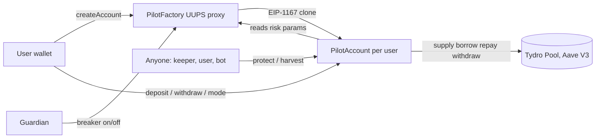

# InkPilot: Design and Pre-Mortem

Status: Draft for review. Target: Ink Sepolia (testnet, chain 763373) with either a real Tydro test market or a demo stand-in pool. Mainnet is deliberately not configured. Solidity 0.8.28, Foundry, OpenZeppelin 5.6.1 (UUPS).

## 0. Read this first: what is and is not promised

1. **"No-loss guarantee" is not something any contract can honestly promise.** InkPilot is built as **capital protection**: it makes liquidation very unlikely and cuts risk automatically, but it cannot remove protocol risk (Tydro pause or bad debt, a USDC depeg, a bug in Aave or in InkPilot, a long sequencer halt). All UI copy says "Protected", never "Guaranteed". If you want a true guarantee it has to be a funded insurance backstop, which v1 does not have.
2. **Tydro and Nado addresses are not in Arc Studio's registry.** Nothing here hardcodes them. Production config takes the Tydro `Pool` address as an input you verify yourself. The Ink Sepolia demo uses `DemoTydroPool` (built on `MockTydroPool`), an Aave V3 shaped stand-in with demo-only switches (freeze, accrue interest).
3. **The Nado leg is designed but not shipped in v1.** Its onchain interface and SDK behaviour are unverified from here. Shipping an adapter against a guessed interface would be the exact bug class the brief warns about.

## 1. Product shape

| Mode | What happens | Liquidation possible? |
| --- | --- | --- |
| Earn (default) | USDC supplied to Tydro. No debt. | No |
| Boost (opt in, max 2x) | Same-asset loop: supply USDC, borrow USDC, resupply. Equity-based leverage capped at 2.00x onchain. | Only via interest drift or a market change |

Why same-asset: collateral and debt are both USDC, so health factor (HF) does not depend on any price. HF = collateral x liquidationThreshold / debt, all in USDC units. That removes oracle manipulation and price-gap risk from the core path. What remains is slow interest drift (borrow APY above supply APY), which is predictable and monitorable, plus governance or market state changes (freeze, LTV changes).

## 2. Architecture



- **One account contract per user.** A shared vault would mean one user's leverage can liquidate everyone. Per-user accounts isolate risk and make "who owns what" provable.
- **Factory is UUPS-upgradeable; accounts are immutable clones.** An upgrade can change what NEW accounts look like but can never alter an existing account's code. A compromised upgrade key cannot touch deposited funds.
- **Protection is permissionless.** `protect()` can be called by anyone. It can only move the account's own funds between its reserve and its Aave position. It can never send funds to a third party except a capped keeper tip. No keeper allowlist means no central point of failure.

### Flow of funds and invariants

| Step | Who moves what | Invariant |
| --- | --- | --- |
| deposit | Owner USDC to account, account supplies to pool | Only the owner can deposit or withdraw |
| fundReserve | Owner USDC to account balance | Reserve is withdrawable by owner at any time |
| protect | Reserve to pool (add collateral or repay) or aTokens repay debt | Funds only go to the pool or the caller tip, tip is capped |
| harvest (Save mode) | Profit from pool to reserve | Principal target never reduced |
| withdraw | Reserve first, then pool, to owner only | After withdraw, HF stays above Tier 1 or debt is zero |

Resting state: the account holds USDC reserve plus aTokens plus debt tokens, nothing else. Factory holds no funds.

## 3. Pre-mortem (Phase 1 answers)

### 3.1 Sequencer halt

Plain truth: if the sequencer is down, no transaction executes. That includes the user's, InkPilot's and liquidators'. No contract can act while the chain is halted.

What the design does instead:
1. **Size positions to survive the gap.** Boost is capped at 2x on a same-asset loop (about 50 percent LTV against a 90 percent class threshold, so HF near 1.8 at open). A halt cannot move HF through price, only through interest, which accrues slowly.
2. **Pre-positioned buffer.** The reserve is already inside the account. When the chain returns, the first `protect()` call can use it in the same block the sequencer resumes.
3. **Liquidation grace period.** Aave V3 on L2 uses a PriceOracleSentinel that blocks liquidations for a grace period after the sequencer returns. InkPilot exposes `liquidationsAllowed()` read from the pool's addresses provider (returns true if no sentinel is set). Verify Tydro has the sentinel enabled. If it does not, treat that as a launch blocker for Boost.
4. **Permissionless and force-inclusion friendly.** Anyone can call `protect()`. On an OP Stack chain (verify for Ink), a user can also submit a transaction through the L1 portal, which the chain must include after the sequencing window, even if the sequencer censors or is down.
5. **No keeper dependency.** Our own keeper is a convenience, not a requirement.

### 3.2 Nado and automation-layer bugs (fallback design)

Likely bugs, ranked: (1) X18 fixed point (1e18) versus token decimals (USDC has 6) mixing, a 10^12 error. (2) Signed X18 amounts where a negative number means short. (3) Treating off-chain order acknowledgements as final. (4) Stale WebSocket data treated as live. (5) Product id mismatch after a listing change.

Required fallback for any future Nado adapter:
- The adapter reports a `heartbeat` timestamp and its `valueInUsdc` onchain. The account stores `maxStaleness`.
- If `block.timestamp - heartbeat > maxStaleness`, anyone may call `fallbackToSafe()`: try to unwind, and on failure mark the leg `Quarantined`, stop all new allocation, and keep the Tydro leg whole. User funds in the Tydro leg are never made dependent on the adapter call succeeding (`try/catch`).
- All X18 conversion goes through one audited library with fuzz tests against decimals 6 and 18.
- The adapter holds a hard cap (default 20 percent of equity) so that a total adapter loss is bounded.

### 3.3 Economic threshold for Safe Mode

Rule implemented onchain:

```
act if  expectedLoss(HF) > tip + fixedCost        (always act if HF <= Tier 3 / emergency)
expectedLoss = debt x closeFactor x penalty x P(liquidation | HF)
closeFactor = 50 percent, penalty = liquidationBonus - 100 percent (from the pool's reserve config),
P(liquidation | HF) = piecewise curve set by governance:
   HF < 1.05: 30 percent, < 1.10: 15 percent, < 1.20: 5 percent, < 1.30: 1.5 percent, else 0.25 percent
```

Slippage term: same-asset deposit, repay and withdraw have zero swap slippage by construction. Gas is paid by the caller and rebated by the capped tip. A cost trap is therefore only possible for tiny accounts, and those are not worth protecting economically (and are told so in the UI). The emergency override means a small account is still exited when HF gets close to 1.

Worked example: debt 1,000 USDC, bonus 5 percent, HF 1.25. expectedLoss = 1000 x 0.5 x 0.05 x 0.015 = 0.375 USDC. With tip 0.05 and fixedCost 0.02, the action triggers. For debt 100 USDC at the same HF, expectedLoss is 0.0375 USDC, below cost, so it waits until HF falls further.

### 3.4 Capital protection tiers

| Tier | HF (default) | Action | Needs |
| --- | --- | --- | --- |
| 1 | below 1.30 | Add collateral from reserve until HF reaches 1.45 | Market Active, reserve above 0 |
| 2 | below 1.20 | Repay debt from reserve until HF reaches 1.45 | Reserve above 0 (works while market is frozen) |
| 2b | Tier 1 or 2 with empty reserve | Self-deleverage: repay debt with aTokens until HF reaches 1.45 | Nothing |
| 3 | at or below 1.10 | Exit: repay all debt with aTokens, position becomes Earn | Nothing, works while frozen |

Defaults are governance-set within bounds (Tier 3 not below 1.05, Tier 1 not above 2.00). Cooldown between actions is 60 seconds, except Tier 3 which has none. A circuit breaker (guardian) stops only discretionary actions: opening or increasing leverage, and harvest. **It never blocks risk-reducing actions or owner withdrawals**, because a breaker that stops protection would itself be the failure.

Honest failure cases that remain: Tydro paused (nothing can move), pool insolvency, USDC depeg or freeze, a bug in the pool or in InkPilot, a sequencer halt followed by an unfavourable change in market parameters.

### 3.5 Aave fork risk handling

| Risk (Verichains class) | Detection | Behaviour |
| --- | --- | --- |
| Reserve frozen | Config bit 57 | Status `Frozen`, UI shows "Safe but locked". Supply and borrow blocked upfront, repay and withdraw allowed, protection skips Tier 1 and uses Tier 2 or 2b |
| Reserve paused | Config bit 60 | Status `Paused`, nothing can move, all calls revert with a clean error before touching the pool |
| Reserve inactive | Config bit 56 | Status `Inactive` |
| LTV set to 0 (griefing) | Config bits 0-15 equal 0 | Status `LtvZero`, new borrows and leverage-up blocked, withdraw may be restricted by the pool, UI explains |
| Flash loan premium or e-Mode oracle issues | Not used | InkPilot never uses flash loans or e-Mode oracles. Unwinds use `repayWithATokens`, no flash loan |
| Pool call reverts or returns nonsense | try/catch around data reads | `protect()` reverts with `PoolUnavailable`, no partial state change |

## 4. Contract design

### PilotFactory (UUPS, Ownable2Step)
- `initialize(owner, accountImpl, pool, usdc, guardian)`; implementation constructor calls `_disableInitializers()`.
- `createAccount(address referrer)`: one account per owner, deterministic clone (CREATE2 with owner salt), emits `AccountCreated(owner, account, referrer)`. Referrer is an event only, no payout.
- Governance (owner, to be a multisig plus timelock in production): `setAccountImplementation` (new accounts only), `setRiskParams` (bounded), `setGuardian`.
- Guardian: `setBreaker(bool)` only. Two-step ownership. No `renounceOwnership`.
- Storage: ERC-7201 style via OpenZeppelin upgradeable base contracts, plus explicit `__gap`.

### PilotAccount (EIP-1167 clone, initializer)
- Owner: `deposit`, `fundReserve`, `withdraw`, `withdrawAll`, `setProfitMode`, `boostTo(targetBps)` (max 20000), `deleverageTo`, `setMaxTip`, `emergencyExit`, `rescue(token, to)` (never the asset or aToken).
- Anyone: `protect()`, `harvest()`.
- Views: `snapshot()` (collateral, debt, reserve, HF, equity, profit, status), `marketStatus()`, `liquidationsAllowed()`.
- All external-call functions are `nonReentrant`. Approvals are exact and reset to zero after use. USDC via `SafeERC20`.
- Events: `Deposited`, `ReserveFunded`, `Withdrawn`, `Protected(tier, hfBefore, hfAfter, amount, caller)`, `ProfitHarvested`, `ProfitModeChanged`, `Boosted`, `Deleveraged`, `ExitedToEarn`, `ProtectionSkipped(reason)`.

### Roles and blast radius

| Role | Can | Worst case if key compromised | Mitigation |
| --- | --- | --- | --- |
| Account owner (user) | Everything on own account | Own funds | User wallet security |
| Factory owner | Risk params (bounded), new account implementation, upgrade factory | Bad params only affect thresholds within bounds. Cannot touch existing accounts or funds | Multisig and timelock, bounds in code, two-step transfer |
| Guardian | Turn breaker on or off | Can stop leverage-up and harvest. Cannot stop protection or withdrawals | Separate key, auto-expiry of breaker (7 days) |
| Anyone | `protect`, `harvest` | Can trigger a tip (capped) when the action is genuinely needed | Cooldown, HF gate, cap per action and per account |

## 5. Security table

| Risk | Applicable | Mitigation |
| --- | --- | --- |
| Reentrancy | Yes | CEI plus `nonReentrant` on every external-call function |
| Access control | Yes | Owner-only account functions, bounded governance, separate guardian |
| Overflow | Checked math | No `unchecked` except a documented loop counter |
| Unchecked external call | Yes | SafeERC20, check pool return values, try/catch on views |
| Fee-on-transfer | USDC only | Balance-delta check on deposit |
| Signature replay | N/A | No signatures in v1 |
| MEV / front-running | Low | Same-asset actions, no swaps, no slippage |
| Oracle manipulation | Minimal | HF derived from same-asset units, pool HF used as a cross-check only |
| DoS | Yes | Bounded loops (max 10), no unbounded arrays |
| Delegatecall / proxy | Factory only | UUPS with `_authorizeUpgrade` onlyOwner, initializers disabled, clones have no upgrade path |
| Tip griefing | Yes | Tip only if an action was needed, capped per action and per user setting, cooldown |
| Approval persistence | Yes | Exact approvals, reset after use |
| Centralization | Yes | Documented above, upgrade cannot reach existing accounts |

## 6. Testing strategy

Foundry unit tests for every tier and every revert, fuzz tests on tier math (HF after action at or above target or the position is fully unwound), invariants (owner can always withdraw reserve, protect never sends funds to a non-pool address except the tip), frozen and paused flows, and the economic gate. Fork tests against real Tydro are an open item for the Ink mainnet path and need the verified Tydro address. Static analysis with Slither. Command: `forge test`.

## 7. Growth engine (ethical, no fake incentives)

1. **Protection Receipt**: after every `Protected` event the app produces a shareable card ("InkPilot added 50 USDC and kept my position safe") with a link built by the share helper. This is the only growth loop that is also a product proof.
2. **Referral link**: `?ref=<address>` is carried into `createAccount(referrer)` and shows on the factory event. No token or payout in v1. If a fee is added later (for example a share of the harvest profit), referrers can be paid from it. Fee modelling is not in scope for v1.
3. **Safety Score**: a visible 0 to 100 score from HF, reserve cover and market status, so people compare and share it.
4. **Public activity feed**: plain-language log from onchain events.
Anti-abuse: no rewards in v1, so there is nothing to farm. Self-referral is harmless for the same reason.

## 8. Open items before mainnet

1. Verify the Tydro Pool, data provider, price oracle sentinel and eMode config on Ink, and the real reserve flags.
2. Verify Nado interface and SDK if the derivatives leg is wanted.
3. Fork tests on Ink, independent third-party audit, timelock and multisig for the factory owner.
4. Run the keeper on your own infrastructure and monitor `Protected`, `ProtectionSkipped`, and HF distribution.
