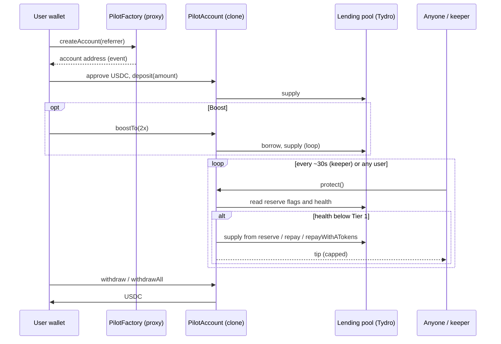

# InkPilot Tech Spec

## Target network: Ink Sepolia (testnet)

| Parameter | Value | Source |
| --- | --- | --- |
| Chain ID | 763373 | RPC `eth_chainId` returned 0xba5ed |
| RPC | https://rpc-gel-sepolia.inkonchain.com | viem chain definition |
| Explorer (Blockscout) | https://explorer-sepolia.inkonchain.com | viem chain definition, API reachable |
| Gas token | ETH (test) | viem chain definition |
| Block time | 1.0 s | measured over 1,000 blocks |
| Multicall3 | 0xcA11bde05977b3631167028862bE2a173976CA11 | code present |

Addresses are produced by `./deploy.sh deploy` and written to `.env` (`VITE_PILOT_*`). They are not stored in this document. Nothing is deployed yet by this project on Ink Sepolia.

Asset: 6-decimal stablecoin. No standard test USDC was found for Ink Sepolia, so `deploy.sh` deploys a public-faucet `TestUSDC` unless you pass `ASSET`.
Pool: your Tydro test market if you pass `POOL` (verify with `bun run tydro:verify`), otherwise the open `DemoTydroPool`.
Testnet limits: the timelock proposer and the guardian default to the shared platform wallet, so nobody in this project can queue an upgrade or flip the breaker. Replace both with real keys before anything beyond a demo.

## Transaction flow

## Protection tiers (defaults, set per account at creation)

| Health | Action |
| --- | --- |
| below 1.30 | Add collateral from reserve to reach 1.45 |
| below 1.20 | Repay debt from reserve to reach 1.45 |
| reserve empty or too small | Repay debt with the position's own aTokens (self-deleverage) |
| at or below 1.10 | Exit to Earn mode (repay everything with aTokens) |

Market Frozen: Tier 1 is skipped, repay paths still work. Paused: clean revert, nothing sent.

## UUPS and timelock

- `PilotFactory` is `UUPSUpgradeable` (ERC-1822 / ERC-1967) with `Ownable2StepUpgradeable`. `_authorizeUpgrade` is `onlyOwner`. The logic contract's constructor calls `_disableInitializers()`.
- The owner is `PilotTimelock` (OpenZeppelin `TimelockController`, minimum delay 172,800 seconds, no admin). An upgrade is `schedule`, wait 48 hours, then `execute` of `upgradeToAndCall`.
- `renounceOwnership` reverts. Ownership moves in two steps.
- Accounts are minimal-proxy clones with no upgrade path. Factory upgrades can change what new accounts look like, never existing ones. Existing accounts may opt in to new defaults with `adoptFactoryParams()`.

## On-chain versus off-chain

| Onchain, no admin can override | Offchain, never holds funds |
| --- | --- |
| deposit, withdraw, reserve, profit mode, boost cap, protection tiers, cooldown, tip cap, status checks | Plan builder in chat (rule-based), keeper, alerts, public stats reader |

## Libraries

OpenZeppelin Contracts 5.6.1 and Contracts-Upgradeable 5.6.1, Foundry (forge, 0.8.28, Cancun), React 18, Vite, wagmi 2, viem 2, ConnectKit, Tailwind, framer-motion.

## Using a real Tydro test market

1. Get the Pool or PoolAddressesProvider and the asset address from Tydro's own documentation or the Tydro app in testnet mode, never from this document.
2. Run `bun run tydro:verify -- --pool <pool> --asset <asset>` and read every line, especially the sentinel and liquidity warnings.
3. Pass them to `./deploy.sh` as `POOL` and `ASSET`.
4. Gas on Ink is ETH. A paymaster is needed for USDC-only users and is not built.
